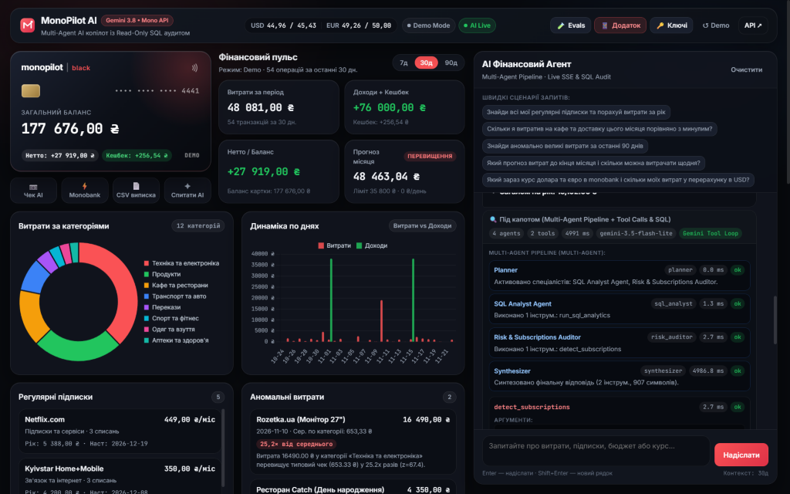
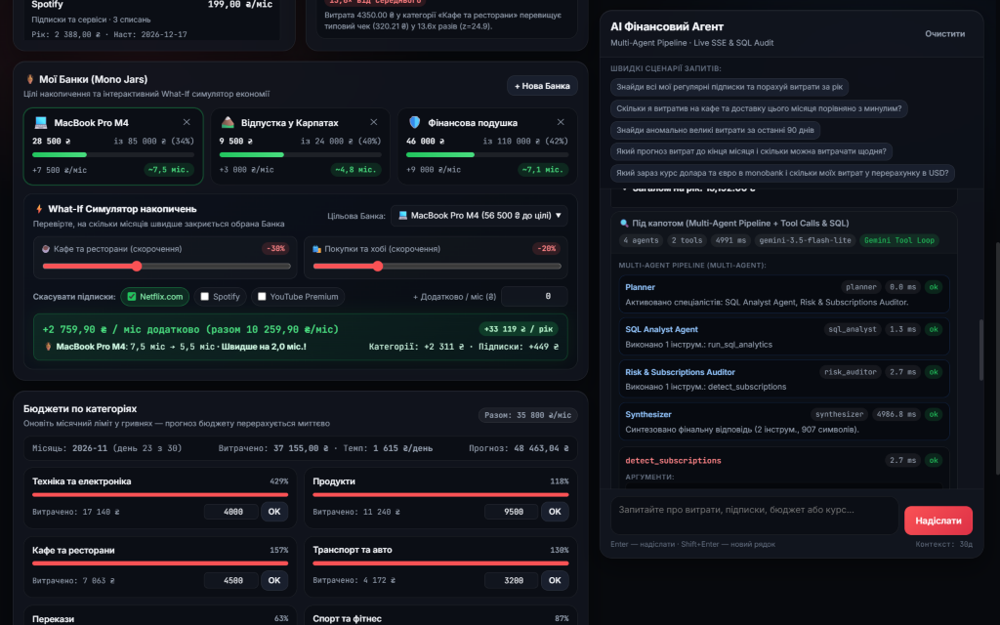
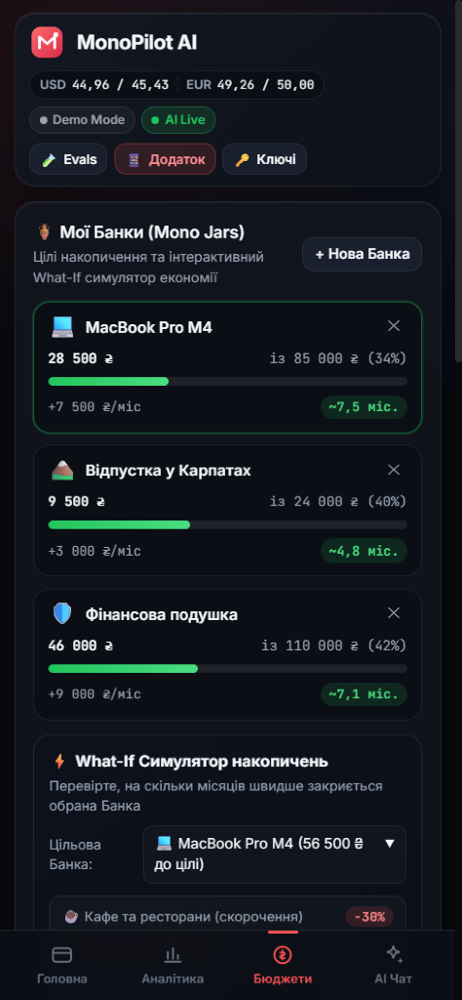
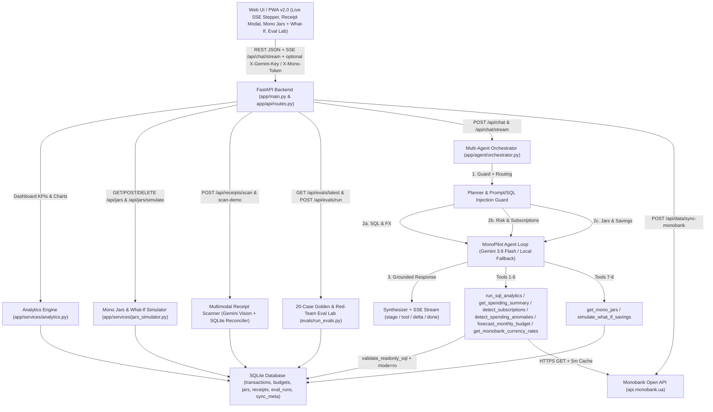

# MonoPilot AI v2.0

[](https://github.com/Demetriusnow/monopilot-ai/actions/workflows/ci.yml)


[](https://render.com/deploy?repo=https://github.com/Demetriusnow/monopilot-ai)

> **English Summary for Reviewers:** MonoPilot AI v2.0 is a production-structured fintech analytics copilot built with **FastAPI**, **SQLite**, **Monobank Open API**, and **Gemini 3.8 Flash (`google-genai` Interactions API)**. v2.0 upgrades the platform with a **Multi-Agent Orchestrator & Live SSE Streaming** (`Planner → SQL Analyst / Risk Auditor / Savings Strategist → Synthesizer`), a **Multimodal Receipt Vision Scanner** with structured JSON schema extraction and SQLite transaction reconciliation, **Mono Jars (`Банки`) + Interactive What-If Savings Simulator**, and an automated **20-Case Golden Benchmark & Red-Team Security Lab** achieving **100.0% numeric accuracy**, **100.0% tool accuracy**, and **100.0% prompt/SQL injection block rate** in deterministic evaluation mode. Works out-of-the-box with zero API keys and upgrades seamlessly to live Monobank statements and Gemini tool-calling via `sessionStorage` or `.env`.

---

## Що нового у v2.0

1. **Multi-Agent Orchestration + Live SSE Streaming (`POST /api/chat/stream`):**
   - Оркестратор `MultiAgentOrchestrator` (`app/agent/orchestrator.py`) автоматично планує профільних спеціалістів (**Planner → SQL Analyst / Risk Auditor / Mono Jars & Savings Strategist → Synthesizer**), фільтрує Prompt/SQL-ін'єкції ще до запуску інструментів і транслює в браузер події `stage`, `tool`, `delta` та `done` через Server-Sent Events (SSE).
   - У чаті з'являється живий **Pipeline Stepper** (`🧠 Планування → 🗄️ SQL / Tools → ✍️ Синтез`), стрічка live tool calls, а в інспекторі **«🔍 Під капотом (Multi-Agent Pipeline + Tool Calls & SQL)»** видно трасування кожного агента та SQL-запиту.
2. **Multimodal Receipt Vision Scanner (`POST /api/receipts/scan`, `POST /api/receipts/scan-demo`):**
   - Сканер чеків (`app/services/receipt_scanner.py`) передає зображення в **Gemini Vision** із жорсткою JSON-схемою (`response_format`), витягує мерчанта, дату, підсумок, MCC-категорію та позиції, після чого автоматично звіряє покупку з транзакціями в SQLite (з оцінкою впевненості) або створює нову транзакцію при `auto_add=true`.
   - Для миттєвого тестування без ключа вбудовано реалістичний демо-чек Сільпо (`✨ Демо-чек Сільпо`).
3. **Mono Jars (`Банки`) + What-If Симулятор накопичень (`GET/POST/DELETE /api/jars`, `POST /api/jars/simulate`):**
   - Керування фінансовими цілями («Мої Банки») із прогрес-барами, залишком та горизонтом закриття (`months_to_goal`).
   - Інтерактивний What-If симулятор (`app/services/jars_simulator.py`) миттєво рахує економію на місяць/рік і скорочення терміну досягнення цілі при зменшенні витрат у категоріях, скасуванні підписок чи додатковому внеску — доступний як у Web UI, так і через інструменти агента (`get_mono_jars`, `simulate_what_if_savings`).
4. **AI Eval & Red-Team Security Lab (`GET /api/evals/latest`, `POST /api/evals/run`):**
   - Вбудований 20-кейсовий Golden & Red-Team Benchmark (`evals/golden_benchmark.json`, `evals/run_evals.py`) із трьома наборами: **Numeric Accuracy** (8 кейсів), **Tool Routing Accuracy** (7 кейсів) та **Red-Team Security Defense** (5 кейсів SQL/Prompt Injection).
   - У детермінованому режимі (`mode=deterministic`) демонструє **20/20 PASS** (**100.0% Numeric Accuracy**, **100.0% Tool Accuracy**, **100.0% Security Block Rate**) зі збереженням результатів у SQLite (`eval_runs`) та візуальним дашбордом у модалці **«🧪 Evals»**.

---

## Про проєкт та архітектурний принцип

**MonoPilot AI** — персональний AI-копілот для аналізу банківських витрат на базі екосистеми **monobank Open API** та **Gemini 3.8 Flash**.

Більшість фінансових чат-ботів припускаються критичної інженерної помилки: передають «сирі» транзакції в контекст LLM і просять модель рахувати суми самостійно, що призводить до галюцинацій у копійках, відсотках та підписках. У **MonoPilot AI** реалізовано підхід **Tool-Grounded Multi-Agent Analytics**:

- LLM **ніколи не виконує арифметику «в голові»** — усі підрахунки виконуються детермінованими інструментами Python та SQL-агрегаціями над SQLite.
- Під кожною відповіддю агента користувач бачить інтерактивний блок **«🔍 Під капотом (Multi-Agent Pipeline + Tool Calls & SQL)»** із таймінгом кожного агента, викликами інструментів та реальним SQL-запитом.
- Проєкт запускається **з нуля без жодних API-ключів** (детермінований 90-денний український Demo-датасет + локальний аналітичний fallback) і миттєво перемикається на реальний **Monobank X-Token** та **Gemini API Key** (які зберігаються лише в `sessionStorage` браузера або `.env`).

---

## Скріншоти інтерфейсу

### Дашборд витрат, графіки, підписки, аномалії та живий курс валют


### Mono Jars, What-If симулятор, бюджети та інспектор Multi-Agent SQL (`🔍 Під капотом`)


### Мобільна версія (PWA-апка для iOS та Android)
Встановлюється на головний екран смартфона як окремий додаток (`display: standalone`) із нижнім банківським меню на 4 вкладки (**Головна · Аналітика · Бюджети · AI Чат**):

- **Android (Chrome):** відкрийте сайт -> натисніть кнопку **«📱 Додаток»** -> **«Встановити додаток»** (або меню `⋮ -> Додати на головний екран`).
- **iPhone (Safari):** відкрийте сайт -> кнопка **«Поділитися»** ↗ -> **«На Початковий екран»** -> **«Додати»**.



---

## Архітектура системи (v2.0)



---

## Захист від галюцинацій та безпека даних (Anti-Hallucination & Security)

1. **Multi-Layer Prompt & SQL Injection Defense (`app/agent/orchestrator.py` & `app/data/database.py`):**
   - На рівні оркестратора `is_prompt_injection_attempt()` миттєво блокує спроби обходу системних інструкцій, витоку секретів або деструктивні SQL-команди (`DROP`, `DELETE`, `UPDATE`, `INSERT`, `ATTACH`, `PRAGMA`, stacked `; ...`), фіксуючи етап `risk_auditor` зі статусом `blocked` без жодних змін у БД.
   - На рівні БД `validate_readonly_sql()` пропускає виключно одиночні запити `SELECT` або `WITH ... SELECT`, а виконання відбувається через SQLite URI `?mode=ro` + `PRAGMA query_only = ON;` з обмеженням `max_rows`.
2. **Multi-Agent & Tool Trace Inspector у Web UI:**
   - Кожна відповідь `/api/chat` і подія `done` у `/api/chat/stream` повертає `ChatResponse` із `agent_pipeline: list[AgentStageTrace]`, `orchestration_mode` та `tool_traces: list[ToolTrace]`.
   - Користувач у реальному часі бачить кроки агентів і може перевірити походження будь-якої цифри чи SQL-запиту.
3. **XSS-безпечний фронтенд та ефемерне зберігання ключів:**
   - Рендеринг markdown, таблиць, результатів чека й eval-таблиці виконує `escapeHtml()` **до** формування DOM.
   - Опціональні ключі (`Gemini API Key` та `Monobank X-Token`) у браузері зберігаються **тільки в `sessionStorage`** поточної вкладки та передаються через заголовки `X-Gemini-Key` і `X-Mono-Token`.
4. **Multi-Model Resilience (`gemini-3.8-flash` -> `gemini-3.5-flash-lite` -> `gemini-3.1-flash-lite`):**
   - Автоматичний failover при `503` / `429` / timeout як для текстового agent loop, так і для Multimodal Receipt Vision (`_extract_via_gemini_vision`), із санітизацією model-specific `thought` кроків.

---

## Завантаження виписки (CSV), інтерактивні бюджети та Mono Jars

- **Monobank CSV Statement Upload (`POST /api/data/upload-csv`):** імпорт експортованих CSV-виписок monobank (українські та англійські заголовки, десяткові коми `DD.MM.YYYY HH:MM:SS`, UTF-8 / Windows-1251, ідемпотентний повторний імпорт).
- **Interactive Category Budgets (`GET/PUT /api/budgets`):** прогрес-бари поточних витрат із миттєвим оновленням місячного ліміту та перерахунком прогнозу.
- **Mono Jars & What-If Simulator (`GET/POST/DELETE /api/jars`, `POST /api/jars/simulate`):** створення та видалення накопичувальних Банок, повзунки скорочення категорій («Кафе та ресторани», «Покупки та хобі»), вибір підписок для скасування й оцінка прискорення досягнення мети в місяцях.

---

## Можливості аналітики та 8 інструментів агента

| Інструмент | Агент-спеціаліст | Призначення |
|---|---|---|
| `run_sql_analytics` | `SQL Analyst` | Виконання безпечних аналітичних `SELECT` / `WITH ... SELECT` запитів до SQLite. |
| `get_spending_summary` | `SQL Analyst` | Зведені витрати, доходи, нетто-потік, кешбек, топ-категорії та топ-мерчанти. |
| `get_monobank_currency_rates` | `SQL Analyst` | Актуальний курс валют (`USD`, `EUR`, `PLN`, `GBP`) з Monobank Open API + 5-хв кеш. |
| `detect_subscriptions` | `Risk Auditor` | Пошук регулярних підписок, розрахунок місячної/річної вартості та наступного списання. |
| `detect_spending_anomalies` | `Risk Auditor` | Виявлення статистично аномальних покупок із коефіцієнтом перевищення середнього чеку. |
| `forecast_monthly_budget` | `Savings Strategist` | Daily burn rate, прогноз витрат до кінця місяця, статус бюджету та безпечний денний ліміт. |
| `get_mono_jars` | `Savings Strategist` | Перелік накопичувальних Банок із прогресом, залишком та `months_to_goal`. |
| `simulate_what_if_savings` | `Savings Strategist` | What-If моделювання скорочення категорій і підписок для прискорення закриття Банки. |

---

## Структура проєкту

```text
MonoPilotAI/
├── app/
│   ├── agent/
│   │   ├── mono_agent.py        # Gemini 3.8 Flash Interactions API loop + failover + fallback
│   │   ├── orchestrator.py      # Multi-Agent Planner/Auditors/Synthesizer, Guard & SSE Stream
│   │   └── tools.py             # Декларації 8 інструментів та async-диспетчер із ToolTrace
│   ├── api/
│   │   └── routes.py            # REST & SSE API (/api/chat/stream, /receipts/*, /jars/*, /evals/*)
│   ├── data/
│   │   ├── database.py          # Схема SQLite (6 таблиць), Read-Only SQL Guard, Jars/Receipts/Evals
│   │   ├── demo_seed.py         # Детермінований 90-денний український демо-датасет
│   │   └── mcc_catalog.py       # Каталог MCC-кодів і правила категоризації
│   ├── services/
│   │   ├── analytics.py         # Підписки, аномалії, прогноз бюджету, зведення дашборду
│   │   ├── csv_importer.py      # Парсер та ідемпотентний імпортер CSV-виписок Monobank
│   │   ├── jars_simulator.py    # Сервіс Mono Jars ('Банки') та What-If симулятор накопичень
│   │   ├── monobank_client.py   # Клієнт Monobank Open API (виписка + курси валют)
│   │   └── receipt_scanner.py   # Gemini Vision сканер чеків + SQLite transaction reconciler
│   ├── static/
│   │   ├── icons/               # PWA-іконки (icon.svg, icon-192.png, icon-512.png, apple-touch-icon.png)
│   │   ├── demo-receipt.png     # Вбудований реалістичний демо-чек Сільпо для Receipt Vision
│   │   ├── index.html           # Web UI v2.0 + модалки Receipt Vision / Evals + 4-табове PWA меню
│   │   ├── manifest.webmanifest # Web App Manifest для iOS та Android
│   │   ├── styles.css           # Glassmorphism dark UI, SSE Stepper, Jars/What-If & PWA layout
│   │   ├── sw.js                # Root-scoped Service Worker для офлайн-оболонки
│   │   └── app.js               # SSE клієнт, Chart.js, Receipt Vision, Jars + What-If & Eval Lab
│   ├── config.py                # Pydantic Settings (змінні середовища / .env)
│   ├── main.py                  # Точка входу FastAPI + lifespan автоініціалізація БД
│   └── schemas.py               # Спільні Pydantic v2 моделі (v1 + v2.0)
├── evals/
│   ├── golden_benchmark.json    # 20-кейсовий датасет (8 numeric, 7 tool, 5 red-team)
│   └── run_evals.py             # CLI та async runner для оцінки точності й безпеки агентів
├── tests/
│   ├── test_sql_safety.py       # Перевірка Read-Only SQL Guard та CTE запитів
│   ├── test_analytics.py        # Тести MCC, підписок, аномалій та прогнозу бюджету
│   ├── test_api.py              # Інтеграційні тести базових FastAPI endpoints та PWA
│   ├── test_agent_mock.py       # Мок-тести Interactions API (single, parallel, 503 failover)
│   ├── test_csv_and_budgets.py  # Тести парсингу Monobank CSV та API бюджетів
│   └── test_v2_platform.py      # v2.0 тести (Multi-Agent SSE, Vision Receipt, Jars/What-If, 20 Evals)
├── .github/workflows/ci.yml     # GitHub Actions CI (Python 3.13 + pytest -v)
├── render.yaml                  # 1-Click Cloud Deploy blueprint для Render.com (Docker)
├── Dockerfile                   # Python 3.13 slim контейнер із non-root користувачем
├── docker-compose.yml           # Запуск сервісу з persistent volume та healthcheck
├── requirements.txt
└── .env.example
```

---

## Швидкий старт (Quickstart)

### 1. Локальний запуск (Python 3.13+)

```powershell
# Клонування або перехід у директорію проєкту
cd E:\MonoPilotAI

# Створення та активація віртуального середовища
py -m venv .venv
.\.venv\Scripts\Activate.ps1

# Встановлення залежностей
pip install -r requirements.txt

# (Опціонально) налаштування змінних середовища
copy .env.example .env

# Запуск сервера розробки
uvicorn app.main:app --reload
```

Після запуску відкрийте:
- Web UI: [http://127.0.0.1:8000/](http://127.0.0.1:8000/)
- Swagger UI: [http://127.0.0.1:8000/docs](http://127.0.0.1:8000/docs)

> **Примітка:** Якщо `GEMINI_API_KEY` не задано, застосунок автоматично працює у режимі **Demo Mode + Local Tools** — усі 8 аналітичних інструментів, Live SSE streaming, демо-сканер чеків, Mono Jars + What-If симулятор і 20-кейсовий AI Eval Lab повністю функціональні. Ви також можете додати ключі прямо в інтерфейсі через кнопку **«🔑 Ключі»**.

### 2. Запуск AI Benchmark CLI

```powershell
python -m evals.run_evals --mode deterministic
```

### 3. Запуск через Docker Compose

```bash
docker compose up --build
```

Контейнер запускається під non-root користувачем `appuser` на порту `8000` із persistent volume для SQLite (`/app/data/monopilot.db`) та вбудованим healthcheck на `/api/health`.

### 4. 1-Click Cloud Deploy на Render.com

Репозиторій містить [`render.yaml`](render.yaml) (`runtime: docker`, free plan, динамічний `$PORT`, healthcheck `/api/health`):
1. Натисніть **[Deploy to Render](https://render.com/deploy?repo=https://github.com/Demetriusnow/monopilot-ai)** або у панелі Render.com оберіть **New -> Blueprint** і вкажіть цей репозиторій.
2. Додайте опціональну змінну `GEMINI_API_KEY` (або користувачі зможуть вводити власні ключі через UI в `sessionStorage`).

### 5. Запуск тестів

```bash
pytest -v
```

Усі тести використовують ізольовані тимчасові бази даних (`tmp_path`) і моки зовнішніх API — проходження не потребує реальних ключів або доступу в інтернет.
