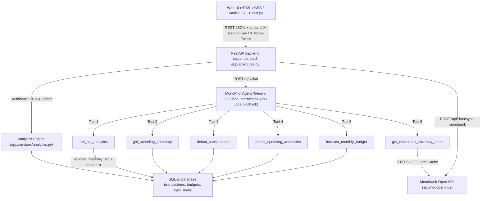

# MonoPilot AI

> **English Summary for Reviewers:** MonoPilot AI is a production-structured fintech analytics copilot built with **FastAPI**, **SQLite**, **Monobank Open API**, and **Gemini 3.8 Flash (`google-genai` Interactions API)**. Every monetary figure, subscription calculation, anomaly flag, and budget projection returned by the AI agent is grounded in deterministic Python/SQL tools and exposed in the UI via a collapsible **Tool Trace & SQL Inspector** (`🔍 Під капотом`), ensuring zero arithmetic hallucination. Works out-of-the-box in Demo Mode (zero API keys required) and seamlessly upgrades to live Monobank statements and Gemini tool-calling via `sessionStorage` or `.env`.

---

## Про проєкт та мотивація для monobank ШІнтернатури (Розробка)

**MonoPilot AI** — персональний AI-копілот для аналізу банківських витрат на базі екосистеми **monobank Open API** та **Gemini 3.8 Flash**.

Більшість фінансових чат-ботів припускаються критичної інженерної помилки: передають «сирі» транзакції в контекст LLM і просять модель рахувати суми самостійно, що призводить до галюцинацій у копійках, відсотках та підписках. У **MonoPilot AI** реалізовано інший підхід — **Tool-Grounded Agentic Analytics**:

- LLM **ніколи не виконує арифметику «в голові»** — усі підрахунки виконуються детермінованими інструментами Python та SQL-агрегаціями над SQLite.
- Під кожною відповіддю агента користувач бачить інтерактивний блок **«🔍 Під капотом (Tool Calls & SQL)»** із точними викликами інструментів, параметрами, часом виконання в `ms` та реальним SQL-запитом.
- Проєкт запускається **з нуля без жодних API-ключів** (детермінований 90-денний український Demo-датасет + локальний аналітичний fallback) і миттєво перемикається на реальний **Monobank X-Token** та **Gemini API Key** (які зберігаються лише в `sessionStorage` браузера або `.env`).

---

## Архітектура системи



---

## Захист від галюцинацій та безпека даних (Anti-Hallucination & Security)

1. **Read-Only SQL Guard (`app/data/database.py`):**
   - Функція `validate_readonly_sql` пропускає виключно одиночні запити `SELECT` або `WITH ... SELECT`.
   - Заборонені ключові слова (`INSERT`, `UPDATE`, `DELETE`, `DROP`, `ALTER`, `CREATE`, `ATTACH`, `PRAGMA`, `VACUUM` тощо), SQL-коментарі (`--`, `/* */`) та stacked statements (`;`) миттєво відхиляються з `ValueError`.
   - Виконання відбувається через SQLite URI `?mode=ro` + `PRAGMA query_only = ON;` з обмеженням `max_rows`.
2. **Tool Trace Inspector у Web UI:**
   - Кожна відповідь `/api/chat` повертає `ChatResponse` з масивом `tool_traces: list[ToolTrace]`, включно з `tool_name`, `arguments`, `sql_query`, `result_preview`, `duration_ms` та `status`.
   - Користувач може перевірити походження будь-якої суми одним кліком.
3. **XSS-безпечний фронтенд та ефемерне зберігання ключів:**
   - Рендеринг markdown (включно з GFM-таблицями) виконує `escapeHtml()` **до** перетворення жирного тексту, списків, таблиць і блоків коду.
   - Опціональні користувацькі ключі (`Gemini API Key` та `Monobank X-Token`) у браузері зберігаються **тільки в `sessionStorage`** поточної вкладки та передаються через заголовки `X-Gemini-Key` і `X-Mono-Token`.
4. **Multi-Model Resilience (`gemini-3.8-flash` -> `gemini-3.5-flash-lite`):**
   - Якщо основна модель тимчасово перевантажена (`503 Service Unavailable`, `429` або timeout), `MonoPilotAgent` автоматично перемикається на резервну модель (`gemini-3.5-flash-lite` / `gemini-3.1-flash-lite`), санітуючи model-specific `thought` кроки при переході посеред діалогу.

---

## Завантаження власної виписки (CSV) та інтерактивні бюджети

- **Monobank CSV Statement Upload (`POST /api/data/upload-csv`):** окрім live API по `X-Token` і вбудованого Demo Mode, у модалці **«Підключити ключі / Monobank»** можна завантажити експортований CSV-файл виписки monobank (підтримуються українські та англійські заголовки, десяткові коми `DD.MM.YYYY HH:MM:SS`, UTF-8 / Windows-1251 та ідемпотентний повторний імпорт).
- **Interactive Category Budgets (`GET/PUT /api/budgets`):** у панелі **«Бюджети по категоріях»** відображаються прогрес-бари поточних витрат із можливістю змінити місячний ліміт у гривнях і миттєво перерахувати прогноз бюджету до кінця місяця.

---

## Можливості аналітики та 6 інструментів агента

| Інструмент | Призначення |
|---|---|
| `run_sql_analytics` | Виконання безпечних аналітичних `SELECT` / `WITH ... SELECT` запитів до таблиць `transactions` та `budgets`. |
| `get_spending_summary` | Зведені витрати, доходи, нетто-потік, кешбек, топ-категорії та топ-мерчанти за період або місяць. |
| `detect_subscriptions` | Пошук регулярних підписок (Netflix, Spotify, YouTube, iCloud+, Kyivstar тощо), розрахунок вартості за місяць/рік і дати наступного списання. |
| `detect_spending_anomalies` | Виявлення статистично аномальних покупок (відхилення від середнього чеку категорії) з коефіцієнтом перевищення. |
| `forecast_monthly_budget` | Розрахунок daily burn rate, прогнозу витрат до кінця місяця, статусу бюджету (`on_track` / `warning` / `over_budget`) і безпечного денного ліміту. |
| `get_monobank_currency_rates` | Актуальний курс валют (`USD`, `EUR`, `PLN`, `GBP`) з Monobank Open API з 5-хвилинним кешем у SQLite та offline fallback. |

---

## Структура проєкту

```text
MonoPilotAI/
├── app/
│   ├── agent/
│   │   ├── mono_agent.py        # Gemini 3.8 Flash Interactions API loop + локальний fallback
│   │   └── tools.py             # Декларації 6 інструментів та async-диспетчер із ToolTrace
│   ├── api/
│   │   └── routes.py            # REST API (/api/health, /dashboard, /transactions, /chat, /data/*)
│   ├── data/
│   │   ├── database.py          # Схема SQLite, Read-Only SQL Guard, execute_safe_select
│   │   ├── demo_seed.py         # Детермінований 90-денний український демо-датасет
│   │   └── mcc_catalog.py       # Каталог MCC-кодів і правила категоризації
│   ├── services/
│   │   ├── analytics.py         # Підписки, аномалії, прогноз бюджету, зведення дашборду
│   │   ├── csv_importer.py      # Парсер та ідемпотентний імпортер CSV-виписок Monobank
│   │   └── monobank_client.py   # Клієнт Monobank Open API (виписка + курси валют)
│   ├── static/
│   │   ├── index.html           # Інтерфейс дашборду та AI-чату
│   │   ├── styles.css           # Темна фінтех-тема в стилі monobank
│   │   └── app.js               # Chart.js графіки, бюджети, CSV-завантаження, XSS-safe markdown & SQL inspector
│   ├── config.py                # Pydantic Settings (змінні середовища / .env)
│   ├── main.py                  # Точка входу FastAPI + lifespan автоініціалізація БД
│   └── schemas.py               # Спільні Pydantic v2 моделі запитів і відповідей
├── tests/
│   ├── test_sql_safety.py       # Перевірка Read-Only SQL Guard та CTE запитів
│   ├── test_analytics.py        # Тести MCC, підписок, аномалій та прогнозу бюджету
│   ├── test_api.py              # Інтеграційні тести FastAPI endpoints
│   ├── test_agent_mock.py       # Мок-тести Interactions API (single, parallel, 503 failover)
│   └── test_csv_and_budgets.py  # Тести парсингу Monobank CSV та API бюджетів
├── .github/workflows/ci.yml     # GitHub Actions CI (Python 3.13 + pytest -v)
├── render.yaml                  # 1-Click Cloud Deploy blueprint для Render.com (Docker)
├── Dockerfile                   # Python 3.13 slim контейнер із non-root користувачем
├── docker-compose.yml           # Запуск сервісу з persistent volume та healthcheck
├── requirements.txt
└── .env.example
```

---

## Швидкий старт (Quickstart)

### 1. Локальний запуск (Python 3.13+)

```powershell
# Клонування або перехід у директорію проєкту
cd E:\MonoPilotAI

# Створення та активація віртуального середовища
py -m venv .venv
.\.venv\Scripts\Activate.ps1

# Встановлення залежностей
pip install -r requirements.txt

# (Опціонально) налаштування змінних середовища
copy .env.example .env

# Запуск сервера розробки
uvicorn app.main:app --reload
```

Після запуску відкрийте:
- Web UI: [http://127.0.0.1:8000/](http://127.0.0.1:8000/)
- Swagger UI: [http://127.0.0.1:8000/docs](http://127.0.0.1:8000/docs)

> **Примітка:** Якщо `GEMINI_API_KEY` не задано, застосунок автоматично працює у режимі **Demo Mode + Local Tools** — усі 6 аналітичних інструментів та інспектор SQL повністю функціональні. Ви також можете додати ключі прямо в інтерфейсі через кнопку **«Підключити ключі / Monobank»**.

### 2. Запуск через Docker Compose

```bash
docker compose up --build
```

Контейнер запускається під non-root користувачем `appuser` на порту `8000` із persistent volume для SQLite (`/app/data/monopilot.db`) та вбудованим healthcheck на `/api/health`.

### 3. 1-Click Cloud Deploy на Render.com

Репозиторій містить [`render.yaml`](render.yaml) (`runtime: docker`, free plan, healthcheck `/api/health`):
1. Запуште репозиторій на GitHub.
2. У панелі Render.com оберіть **New -> Blueprint**, вкажіть репозиторій та додайте опціональний `GEMINI_API_KEY`.

### 4. Запуск тестів

```bash
pytest -v
```

Усі тести використовують ізольовані тимчасові бази даних (`tmp_path`) і моки зовнішніх API — проходження не потребує реальних ключів або доступу в інтернет.
